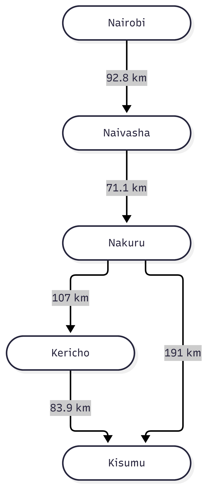
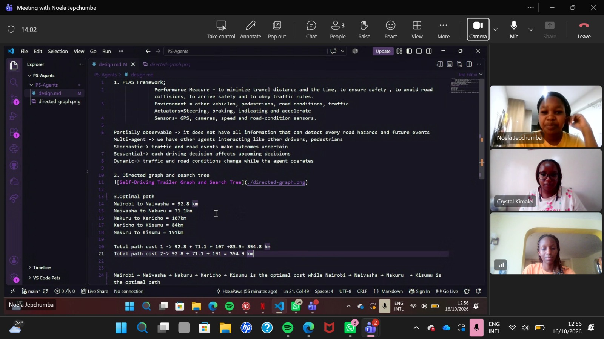

1. PEAS Framework;
              Performance Measure = to minimize travel distance and the time, to ensure safety , to avoid road collisions, to arrive safely and to obey traffic rules.                   
              Environment = other vehicles, pedestrians, road conditions, traffic                 Actuators=Steering, braking, indicating and accelerate             
              Sensors= GPS, cameras, speed and road-condition sensors.

Partially observable -> it does not have all information that can detect every road hazards and future events  Multi-agent -> we have other agents interacting like other drivers, pedestrians                           Stochastic-> traffic and road events make outcomes uncertain               
Sequential-> each driving decision affects upcoming decisions            
Dynamic-> traffic and road conditions change while the agent operates

2. Directed graph and search tree

3.Optimal path 
Nairobi to Naivasha = 92.8 km
Naivasha to Nakuru = 71.1km
Nakuru to Kericho = 107km
Kericho to Kisumu = 84km
Nakuru to Kisumu = 191km

Total path cost 1 -> 92.8 + 71.1 + 107 +83.9= 354.8 km
Total path cost 2-> 92.8 + 71.1 + 191 = 354.9 km

Nairobi → Naivasha → Nakuru → Kericho → Kisumu is the optimal cost while Nairobi → Naivasha → Nakuru  → Kisumu is the optimal path

4. Group-work photo

